<p align="center">
  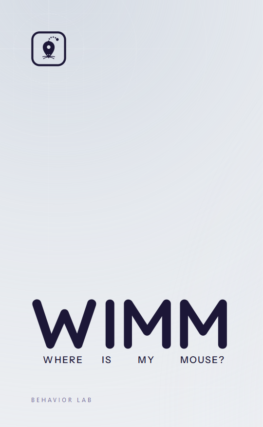
</p>

<p align="center">
  A free, open-source desktop application for video tracking of mouse behaviour.<br>
  13 standard paradigms · no programming · no training data · no graphics card
</p>

---

## What it does

WIMM turns video recordings of a single mouse into behavioural measures and exports them to Excel workbooks.
Every paradigm shares one workflow, one tracking engine and one results screen:

**Video → Arena → Zones → Scale → Detection → Tracking → Results**

Tracking uses classical image analysis (background subtraction), so WIMM needs no training data and no GPU.
It finds the body centre and, where a test needs them, the nose and tail tip. From these it computes locomotor,
zone-based and test-specific measures.

## Supported paradigms

| Domain | Paradigms |
|---|---|
| Locomotion and anxiety-like behaviour | Open field · Elevated plus maze · Elevated zero maze · Light–dark box |
| Learning and memory | Y-maze · Novel object recognition · Object location · T-maze · Radial arm maze · Morris water maze |
| Social behaviour and reward | Three-chamber social test · Conditioned place preference |
| User-defined | Custom experiment with a user-drawn arena and zones |

<table>
  <tr>
    <td align="center">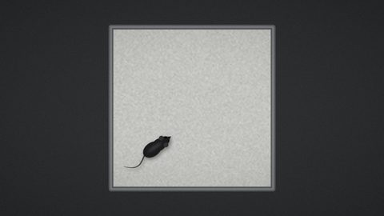<br>Open field</td>
    <td align="center">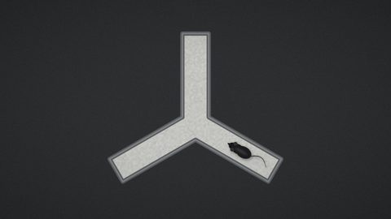<br>Y-maze</td>
    <td align="center">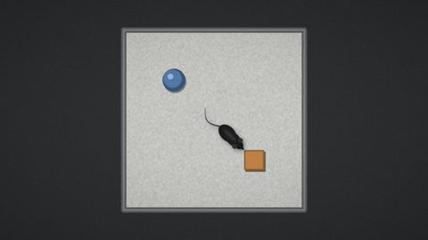<br>Novel object recognition</td>
  </tr>
  <tr>
    <td align="center">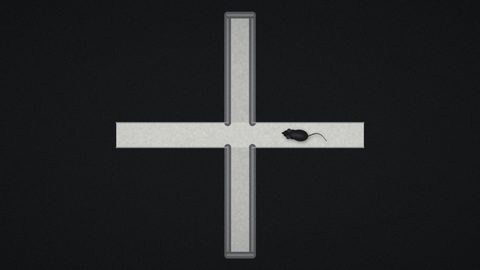<br>Elevated plus maze</td>
    <td align="center">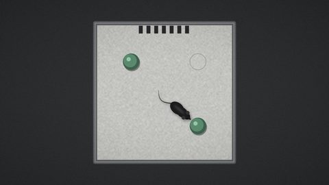<br>Object location</td>
    <td align="center">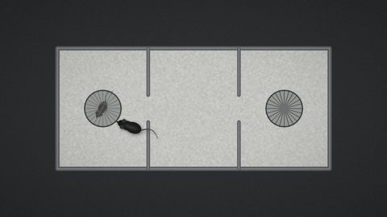<br>Three-chamber social test</td>
  </tr>
  <tr>
    <td align="center">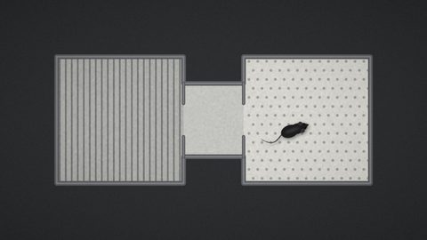<br>Conditioned place preference</td>
    <td align="center">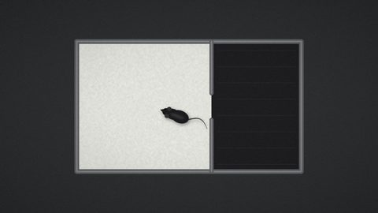<br>Light–dark box</td>
    <td align="center">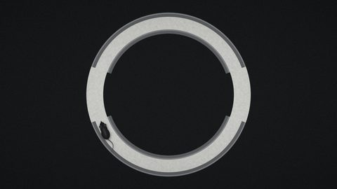<br>Elevated zero maze</td>
  </tr>
  <tr>
    <td align="center"><br>T-maze</td>
    <td align="center">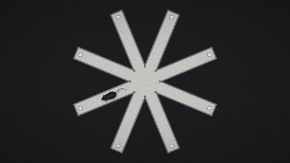<br>Radial arm maze</td>
    <td align="center">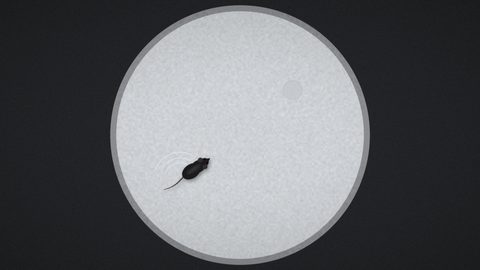<br>Morris water maze</td>
  </tr>
</table>

<sub>Illustrations of each arena (generated images, not real recordings).</sub>

## Main features

- **Graphical interface only.** Every setting has an in-context explanation, and a searchable manual is built in.
- **Batch Run** applies one set of tracking settings to every video in an experiment. Only arena, zones, scale and animal information are set per video.
- **Multi-Run** compares several parameter sets on the same video to find the best settings for a camera.
- **Corrections** let you fix tracking errors frame by frame. Every correction is counted and reported in the export.
- **Excel export** of summary measures, per-frame data, graphs and the full settings used.

## Built-in safeguards

- **No silent guessing.** If the frame rate cannot be read, WIMM stops and asks for it; it never assumes a value.
- **No partial results.** Stopped, failed or cut-short runs are never saved as complete sessions.
- **Consistent positions.** With perspective correction off, positions are never reshaped, so the screen, batch results and every export show the same trajectory.
- **Robust zone entries.** A brief loss of tracking inside a zone is not counted as an exit and re-entry.
- **Full provenance.** Every export records the WIMM version and all parameters used.
- **Tested.** 183 automated tests check measures, scaling, timing and export against cases with known answers.

## Installation (Windows)

### Option 1: ready-to-run app (no Python needed)

1. Download **`WIMM-1.0.0-windows.zip`** from the [Releases](../../releases) page.
2. Unzip it anywhere.
3. Double-click **`WIMM.exe`** in the `WIMM` folder.

Windows may show a "Windows protected your PC" warning because the app is not code-signed. Click **More info → Run anyway**.

### Option 2: run from source

Requirements: Python 3 (tested with Python 3.12), ticked "Add python.exe to PATH" during installation, and internet access on the first run.

1. Download or clone this repository.
2. Double-click **`Run WIMM.bat`**.
   On the first run it creates a virtual environment (`.venv`) and installs the dependencies, which takes a minute. After that, the app starts straight away.

Or from a terminal:

```bash
python -m venv .venv
.venv\Scripts\pip install -r requirements.txt
.venv\Scripts\python main.py
```

Dependencies: PyQt5, OpenCV, NumPy, pandas, openpyxl and matplotlib.

## Recording tips

- A fixed camera above the arena, with the whole arena in view.
- Good contrast between the mouse and the floor. Both dark mice on light floors and white mice on dark floors are supported.
- Even lighting without strong shadows or reflections.

The built-in Help page **Recording videos that track well** has more detail.

## Running the tests

```bash
.venv\Scripts\pip install -r requirements-dev.txt
.venv\Scripts\python -m pytest tests
```

## How WIMM was made

All WIMM source code was generated by Claude (Anthropic) through natural-language instructions; no code was written by hand.
Reliability was pursued through automated tests with known answers, audits of the code against explicitly written scientific rules, and a design that stops instead of guessing.
A manuscript describing this process is in preparation.

## Version

**1.0.0**, frozen for the validation study (tag `v1.0.0`).

## Citation

If you use WIMM in your research, please cite this repository. A citation for the accompanying paper will be added here.

## License

WIMM is released under the [MIT License](LICENSE).
