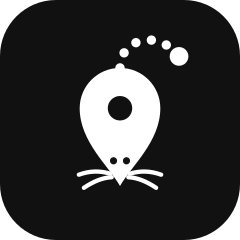

# Логотип трекинга мышей — версии 4b и 4e

## Версии
- **4b — Плитка** (`mouse-track-4b-tile`): основная иконка приложения, фавикон и аватар. Мышь вырезана в залитом квадрате, усики укорочены на 30%.
- **4e — Контур + заливка** (`mouse-track-4e-outline`): для навигации и светлых экранов интерфейса. Мышь залита, квадрат — контур.

## Файлы
- `svg/` — вектор: чёрный `#111111` и белый (`-white`), фон прозрачный. В коде используйте в первую очередь их.
- `png/` — прозрачные PNG размером 1024, 512, 256, 128, 64, 32 и 16 px, чёрный и белый варианты.

## Подключение
**Web**
```html

<link rel="icon" type="image/svg+xml" href="svg/mouse-track-4b-tile.svg">
<link rel="icon" type="image/png" sizes="32x32" href="png/mouse-track-4b-tile-32.png">
```
**React.** Подключите SVG как компонент или через ``. Чтобы задавать цвет из CSS, замените `#111` на `currentColor`.

**iOS.** App Icon — `png/mouse-track-4b-tile-1024.png`. Углы iOS скругляет сама.

**Android.** Импортируйте SVG в Android Studio: Vector Asset. Для adaptive icon: foreground — мышь, background — чёрный.

## Правила
- Свободное поле вокруг знака — не меньше 1/8 его ширины.
- Цвета: только чёрный `#111111` или белый `#FFFFFF`.
- Знак нельзя искажать и дополнять эффектами. Минимальный размер — 16 px.
